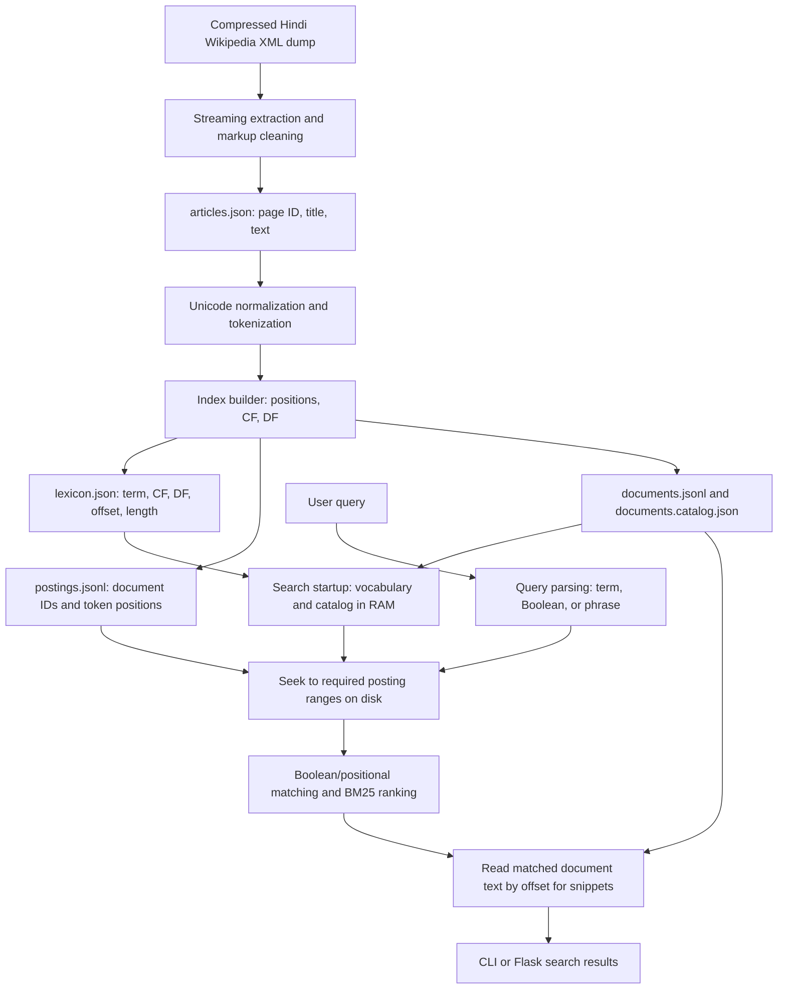

# Hindi Wikipedia Positional Inverted Index Search Engine

A small Information Retrieval system for searching Hindi Wikipedia articles. It extracts article text from a Wikimedia dump, builds a positional inverted index, and supports Boolean retrieval, exact phrase queries, and BM25-ranked results through a command-line program and a Flask web interface.

Hindi was selected as an Indian language for the assignment. The project works with Devanagari text and records term positions so a phrase query can check the original token order and adjacency.

## Features

- Streams a compressed Hindi Wikipedia XML dump and extracts article IDs, titles, and cleaned text.
- Applies Unicode NFC normalization, Devanagari/ASCII tokenization, and a small Hindi stop-word list.
- Builds positional postings and records collection frequency (CF) and document frequency (DF) for each indexed term.
- Loads vocabulary statistics and posting offsets into memory while keeping positional postings on disk.
- Reads a requested posting list by its disk offset and length; document text is also read by offset when a result snippet is needed.
- Supports term queries, Boolean `AND`, `OR`, and binary `NOT`, and double-quoted exact phrases.
- Ranks matching documents with BM25 (`k1 = 1.5`, `b = 0.75`).
- Includes a Flask search page, a complete saved-index validator, and a real-corpus rare-term report generator.

## Architecture

The vocabulary and positional postings are stored separately. At search startup, the complete lexicon metadata and per-document catalog are read into RAM. The postings file itself is not loaded into RAM; a query seeks to each required term's byte offset and reads only its recorded byte length.



### Vocabulary, postings, and document storage

The index builder writes these generated files under `data/`:

| File | Contents | Search-time storage |
| --- | --- | --- |
| `lexicon.json` | Each term's `cf`, `df`, byte `offset`, and byte `length` in the postings file | Loaded into RAM |
| `postings.jsonl` | Compact UTF-8 JSON records mapping document IDs to sorted positions | Read on disk by offset; only requested records are read |
| `documents.catalog.json` | Titles, searchable document lengths, and document-store offsets | Loaded into RAM |
| `documents.jsonl` | Article IDs and text | Read by offset when snippets are needed |
| `metadata.json` | Document count, searchable token count, average length, vocabulary size, and postings file size | Loaded as small metadata |

Despite its `.jsonl` filename, `postings.jsonl` is written as consecutive compact JSON objects without newline separators. Each posting record is one JSON object. The lexicon's offset and byte length identify its exact range in the file; no delimiter scan or whole-file load is needed. Search does not build or retain a complete in-memory postings dictionary. The builder does use temporary in-memory postings while constructing the index.

### Positional postings, CF, and DF

For a term `t`:

- **Collection Frequency (CF)** is the total number of occurrences of `t` across the collection.
- **Document Frequency (DF)** is the number of distinct documents containing `t`.

A positional posting maps each document ID to the 1-based token positions where the term occurs. For example, the following is illustrative, not a corpus result:

```text
Term: भारत
Document 1 → [2, 5, 9]
Document 2 → [4, 8]
```

Here CF is 5 and DF is 2. Repeated occurrences appear at multiple positions, in ascending order. Positions are assigned over the full token sequence before stop-word filtering. Stop words are retained in the positional postings so phrases can match across their true positions. For example, the query `"भारत की राजधानी"` requires the three query terms to occur at consecutive token positions; documents that merely contain all three words with gaps do not match.

CF and DF in `lexicon.json` count all indexed tokens, including stop words. Ordinary term and Boolean query tokenization filters stop words. Searchable document lengths used by BM25 also exclude stop words. The `total_indexed_tokens` field in `metadata.json` is therefore the searchable (stop-word-filtered) token count, while the sum of posting positions also includes stop words.

## Repository structure

```text
.
├── .gitignore              # excludes the Wikipedia data and generated index
├── app.py                 # Flask search interface
├── build_index.py         # builds the vocabulary, postings, catalog, and metadata
├── config.py              # paths, corpus limit, and BM25 parameters
├── evaluate.py            # editable queries and optional manually judged P@10
├── extract_articles.py    # streaming XML extraction and wiki-markup cleaning
├── output.txt             # verified real-corpus rare terms and five query cases
├── prepare_output.py      # regenerates output.txt from the local index
├── preprocess.py          # Unicode normalization, tokenizer, stop words
├── requirements.txt       # Python dependencies
├── search.py              # disk-backed lookup, Boolean/phrase search, BM25
├── validate_index.py      # validates every saved posting record
├── tests/
│   └── test_ir.py         # synthetic Hindi integration tests
└── data/
    └── .gitkeep           # keeps the otherwise empty data directory in Git
```

The dump, extracted articles, and generated index files are local data and are intentionally excluded from Git. The extraction script writes `data/articles.json`; the builder writes the index files listed above.

## Dataset

The source is the Hindi Wikipedia `pages-articles` XML dump from the [official Wikimedia Hindi dump directory](https://dumps.wikimedia.org/hiwiki/latest/). Download the file named `hiwiki-latest-pages-articles.xml.bz2` and save it at:

```text
data/hiwiki-latest-pages-articles.xml.bz2
```

Keep the dump compressed. `extract_articles.py` reads it with Python's `bz2` module and streams XML pages with `xml.etree.ElementTree`. It accepts namespace-zero articles, skips redirects, short pages, and identified disambiguation pages, and retains stable Wikipedia page IDs. The default article limit is 10,000; `--limit` can choose a smaller maximum. The extractor supports an optional `--output` path for the extracted JSON.

Do not commit the dump, extracted dataset, or generated index. The repository's `.gitignore` excludes these files and the index's binary/serialized forms.

## Installation and execution (PowerShell)

Clone the repository and enter its directory:

```powershell
git clone https://github.com/dhanuunjay396/hindi-wikipedia-positional-index.git
Set-Location hindi-wikipedia-positional-index
```

Create and activate a virtual environment, then install the dependencies:

```powershell
python -m venv venv
.\venv\Scripts\Activate.ps1
python -m pip install -r requirements.txt
```

After downloading the dump to the expected location, run extraction and index construction in order:

```powershell
python extract_articles.py
python build_index.py
```

To extract at most 20 valid articles instead, use the supported `--limit` argument:

```powershell
python extract_articles.py --limit 20
```

Run the interactive command-line search:

```powershell
python search.py
```

Enter a query at the prompt and submit an empty line to exit. Queries return up to 10 BM25-ranked results by default. Query syntax examples:

```text
भारत                         # one Hindi term
"भारत की राजधानी"           # exact consecutive phrase
भारत AND इतिहास              # documents containing both terms
भारत OR नेपाल                # documents containing either term
भारत NOT नेपाल               # documents containing भारत but not नेपाल
```

Boolean operators are binary and evaluated left to right; parentheses are not implemented. `NOT` subtracts the right-hand result set from the left-hand set. A phrase must be enclosed in double quotes as a whole. Unknown terms return no results. A single-term query is ranked with BM25, as are the matching documents for Boolean and phrase queries.

Run the test suite, validate the full local index, or run the editable evaluation queries:

```powershell
python -m unittest discover -s tests -v
python validate_index.py
python evaluate.py
```

`validate_index.py` and `evaluate.py` require a locally built index. `evaluate.py` does not provide relevance labels; it reports P@10 only after IDs are manually entered in `relevant_ids`.

Launch the Flask interface:

```powershell
python app.py
```

Then open [http://127.0.0.1:5000](http://127.0.0.1:5000). The app uses Flask's built-in development server with debug mode disabled by default.

## BM25 ranking

The search code uses the following BM25 form with `k1 = 1.5` and `b = 0.75`:

```text
score(D, Q) = Σ IDF(t) × tf(t,D) × (k1 + 1)
              / (tf(t,D) + k1 × (1 - b + b × |D| / avgdl))

IDF(t) = log(1 + (N - df(t) + 0.5) / (df(t) + 0.5))
```

`N` is the indexed document count, `df(t)` is the vocabulary DF, `tf(t,D)` is the number of positions for term `t` in document `D`, `|D|` is the stop-word-filtered document length, and `avgdl` is its collection average. BM25 ranks the term-query candidates or the documents already selected by phrase/Boolean matching.

## Verified results

The following results were verified against the current local index and report. They describe the indexed 10,000-article sample, not the complete or current Hindi Wikipedia collection.

| Measurement | Verified result |
| --- | ---: |
| Articles indexed | 10,000 |
| Searchable tokens (stop words removed) | 3,888,126 |
| Vocabulary terms | 222,126 |
| Total posting occurrences (including stop words) | 5,266,714 |
| Positional postings file size | 43,199,068 bytes |
| Synthetic integration tests | 4 passed |
| Full-index posting validation | 222,126 vocabulary records passed |
| Flask route smoke check | HTTP 200 |
| Rare Hindi terms in `output.txt` | 10; each has DF = 1 |
| Real-index query cases in `output.txt` | 5 passed |

The full-index validator checks each stored term's CF and DF against its posting record, and checks document IDs and ascending positive positions. The synthetic tests cover vocabulary loading, disk retrieval, CF/DF, positions, repeated terms, exact phrase matching, Boolean AND/OR, unknown terms, and reopening the index. The Flask status records a local route smoke check, not a deployed service.

## Output report

[`output.txt`](output.txt) is generated from the actual indexed corpus by `python prepare_output.py`. It contains ten low-DF Hindi terms with CF, DF, document IDs, and positions, followed by five search cases with queries, expected behavior, actual outputs, and pass/fail status. The report uses real corpus data; the synthetic tests are separate and are not presented as Wikipedia results.

## Limitations and future work

- The current build limit is 10,000 valid articles. Indexing the complete dump would require a larger build and storage plan.
- Wiki markup cleanup handles common constructs but is not a complete MediaWiki parser.
- Hindi preprocessing uses NFC normalization, a character-range tokenizer, and a small manually maintained stop-word list; it does not perform stemming or morphological analysis.
- Postings are stored as compact JSON records without compression. Delta encoding or another compressed representation could reduce disk use.
- BM25 is implemented, but the project has no relevance judgments or benchmark-based retrieval evaluation. Manually judged queries and larger-corpus performance benchmarks would be useful extensions.

## References

- [Wikimedia Dumps — Hindi Wikipedia](https://dumps.wikimedia.org/hiwiki/latest/)
- Manning, Raghavan, and Schütze, [*Introduction to Information Retrieval*, Section 2.4: Positional indexes and phrase queries](https://nlp.stanford.edu/IR-book/html/htmledition/positional-indexes-1.html), Stanford University.
- Robertson and Zaragoza, [“The Probabilistic Relevance Framework: BM25 and Beyond”](https://doi.org/10.1561/1500000019), *Foundations and Trends in Information Retrieval*, 2009.
- [Python 3 documentation](https://docs.python.org/3/), including the [`bz2`](https://docs.python.org/3/library/bz2.html), [`json`](https://docs.python.org/3/library/json.html), [`unicodedata`](https://docs.python.org/3/library/unicodedata.html), and [`xml.etree.ElementTree`](https://docs.python.org/3/library/xml.etree.elementtree.html) library references.
- [Flask documentation](https://flask.palletsprojects.com/en/stable/).
